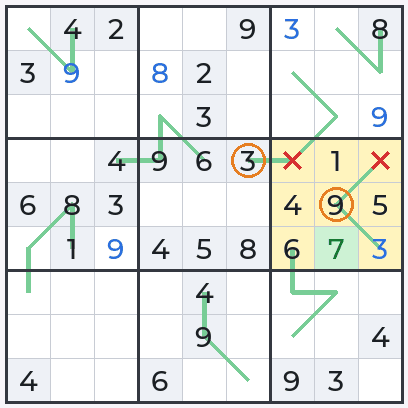

<!-- Written by tools/walkthrough.py german-whispers: edit the script, not this page. -->
# German Whispers, step 7: the 7 in box 6

**Step 7 of 51** · [← Step 6](step-06.md) · [All steps](../german-whispers.md#the-whole-puzzle-step-by-step) · [Step 8 →](step-08.md)

Box 6 needs a 7. r4c7: it's next to the 3 in r4c6 on a green line, and 7 is less than 5 away from it. r4c9: it's next to the 9 in r5c8 on a green line, and 7 is less than 5 away from it. Only **r6c8** is left: **r6c8 = 7**.

**Step 7 of 51** · [← Step 6](step-06.md) · [All steps](../german-whispers.md#the-whole-puzzle-step-by-step) · [Step 8 →](step-08.md)
