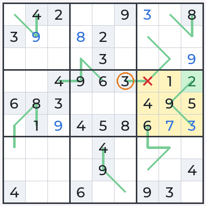

<!-- Written by tools/walkthrough.py german-whispers: edit the script, not this page. -->
# German Whispers, step 8: the 2 in box 6

**Step 8 of 51** · [← Step 7](step-07.md) · [All steps](../german-whispers.md#the-whole-puzzle-step-by-step) · [Step 9 →](step-09.md)

Box 6 needs a 2. r4c7: it's next to the 3 in r4c6 on a green line, and 2 is less than 5 away from it. Only **r4c9** is left: **r4c9 = 2**.

**Step 8 of 51** · [← Step 7](step-07.md) · [All steps](../german-whispers.md#the-whole-puzzle-step-by-step) · [Step 9 →](step-09.md)
