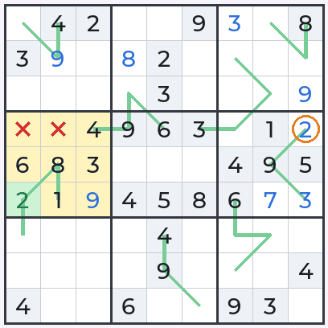

<!-- Written by tools/walkthrough.py german-whispers: edit the script, not this page. -->
# German Whispers, step 9: the 2 in box 4

**Step 9 of 51** · [← Step 8](step-08.md) · [All steps](../german-whispers.md#the-whole-puzzle-step-by-step) · [Step 10 →](step-10.md)

Box 4 needs a 2. r4c1 and r4c2: row 4 has one (r4c9). Only **r6c1** is left: **r6c1 = 2**.

**Step 9 of 51** · [← Step 8](step-08.md) · [All steps](../german-whispers.md#the-whole-puzzle-step-by-step) · [Step 10 →](step-10.md)
