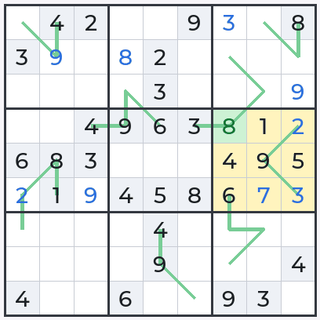

<!-- Written by tools/walkthrough.py german-whispers: edit the script, not this page. -->
# German Whispers, step 10: the 8 in box 6

**Step 10 of 51** · [← Step 9](step-09.md) · [All steps](../german-whispers.md#the-whole-puzzle-step-by-step) · [Step 11 →](step-11.md)

Box 6 needs an 8, and r4c7 is its last empty cell: **r4c7 = 8**.

**Step 10 of 51** · [← Step 9](step-09.md) · [All steps](../german-whispers.md#the-whole-puzzle-step-by-step) · [Step 11 →](step-11.md)
