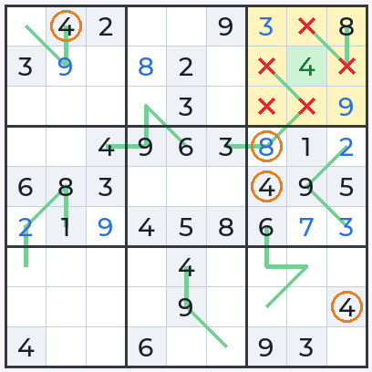

<!-- Written by tools/walkthrough.py german-whispers: edit the script, not this page. -->
# German Whispers, step 11: the 4 in box 3

**Step 11 of 51** · [← Step 10](step-10.md) · [All steps](../german-whispers.md#the-whole-puzzle-step-by-step) · [Step 12 →](step-12.md)

Box 3 needs a 4. r1c8: row 1 has one (r1c2). r2c7 and r3c7: column 7 has one (r5c7). r2c9: column 9 has one (r8c9). r3c8: it's next to the 8 in r4c7 on a green line, and 4 is less than 5 away from it. Only **r2c8** is left: **r2c8 = 4**.

**Step 11 of 51** · [← Step 10](step-10.md) · [All steps](../german-whispers.md#the-whole-puzzle-step-by-step) · [Step 12 →](step-12.md)
