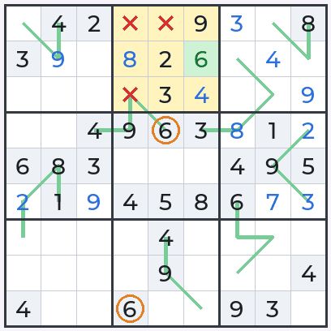

<!-- Written by tools/walkthrough.py german-whispers: edit the script, not this page. -->
# German Whispers, step 13: the 6 in box 2

**Step 13 of 51** · [← Step 12](step-12.md) · [All steps](../german-whispers.md#the-whole-puzzle-step-by-step) · [Step 14 →](step-14.md)

Box 2 needs a 6. r1c4 and r3c4: column 4 has one (r9c4). r1c5: column 5 has one (r4c5). Only **r2c6** is left: **r2c6 = 6**.

**Step 13 of 51** · [← Step 12](step-12.md) · [All steps](../german-whispers.md#the-whole-puzzle-step-by-step) · [Step 14 →](step-14.md)
