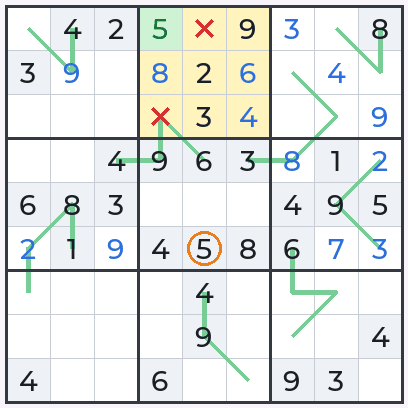

<!-- Written by tools/walkthrough.py german-whispers: edit the script, not this page. -->
# German Whispers, step 14: the 5 in box 2

**Step 14 of 51** · [← Step 13](step-13.md) · [All steps](../german-whispers.md#the-whole-puzzle-step-by-step) · [Step 15 →](step-15.md)

Box 2 needs a 5. r1c5: column 5 has one (r6c5). r3c4: it's on a green line, and nothing is 5 or more away from a 5. Only **r1c4** is left: **r1c4 = 5**.

**Step 14 of 51** · [← Step 13](step-13.md) · [All steps](../german-whispers.md#the-whole-puzzle-step-by-step) · [Step 15 →](step-15.md)
