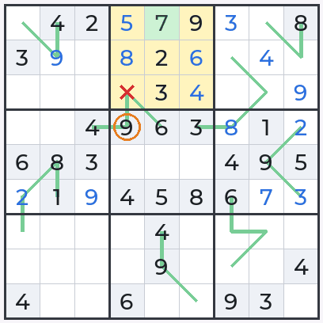

<!-- Written by tools/walkthrough.py german-whispers: edit the script, not this page. -->
# German Whispers, step 15: the 7 in box 2

**Step 15 of 51** · [← Step 14](step-14.md) · [All steps](../german-whispers.md#the-whole-puzzle-step-by-step) · [Step 16 →](step-16.md)

Box 2 needs a 7. r3c4: it's next to the 9 in r4c4 on a green line, and 7 is less than 5 away from it. Only **r1c5** is left: **r1c5 = 7**.

**Step 15 of 51** · [← Step 14](step-14.md) · [All steps](../german-whispers.md#the-whole-puzzle-step-by-step) · [Step 16 →](step-16.md)
