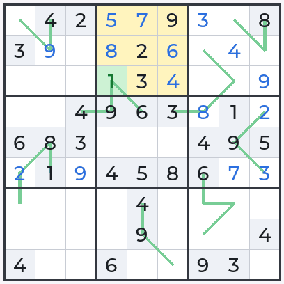

<!-- Written by tools/walkthrough.py german-whispers: edit the script, not this page. -->
# German Whispers, step 16: the 1 in box 2

**Step 16 of 51** · [← Step 15](step-15.md) · [All steps](../german-whispers.md#the-whole-puzzle-step-by-step) · [Step 17 →](step-17.md)

Box 2 needs a 1, and r3c4 is its last empty cell: **r3c4 = 1**.

**Step 16 of 51** · [← Step 15](step-15.md) · [All steps](../german-whispers.md#the-whole-puzzle-step-by-step) · [Step 17 →](step-17.md)
