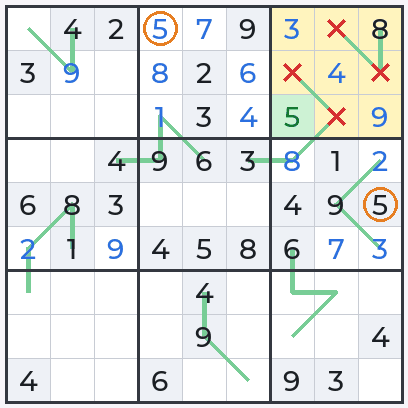

<!-- Written by tools/walkthrough.py german-whispers: edit the script, not this page. -->
# German Whispers, step 17: the 5 in box 3

**Step 17 of 51** · [← Step 16](step-16.md) · [All steps](../german-whispers.md#the-whole-puzzle-step-by-step) · [Step 18 →](step-18.md)

Box 3 needs a 5. r1c8: row 1 has one (r1c4). r2c9: column 9 has one (r5c9). r2c7 and r3c8: it's on a green line, and nothing is 5 or more away from a 5. Only **r3c7** is left: **r3c7 = 5**.

**Step 17 of 51** · [← Step 16](step-16.md) · [All steps](../german-whispers.md#the-whole-puzzle-step-by-step) · [Step 18 →](step-18.md)
