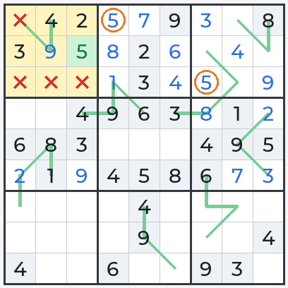

<!-- Written by tools/walkthrough.py german-whispers: edit the script, not this page. -->
# German Whispers, step 18: the 5 in box 1

**Step 18 of 51** · [← Step 17](step-17.md) · [All steps](../german-whispers.md#the-whole-puzzle-step-by-step) · [Step 19 →](step-19.md)

Box 1 needs a 5. r1c1: row 1 has one (r1c4). r3c1, r3c2 and r3c3: row 3 has one (r3c7). Only **r2c3** is left: **r2c3 = 5**.

**Step 18 of 51** · [← Step 17](step-17.md) · [All steps](../german-whispers.md#the-whole-puzzle-step-by-step) · [Step 19 →](step-19.md)
