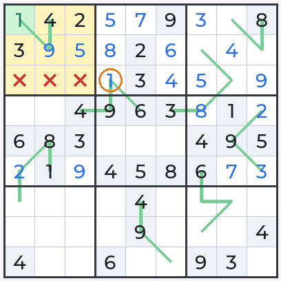

<!-- Written by tools/walkthrough.py german-whispers: edit the script, not this page. -->
# German Whispers, step 19: the 1 in box 1

**Step 19 of 51** · [← Step 18](step-18.md) · [All steps](../german-whispers.md#the-whole-puzzle-step-by-step) · [Step 20 →](step-20.md)

Box 1 needs a 1. r3c1, r3c2 and r3c3: row 3 has one (r3c4). Only **r1c1** is left: **r1c1 = 1**.

**Step 19 of 51** · [← Step 18](step-18.md) · [All steps](../german-whispers.md#the-whole-puzzle-step-by-step) · [Step 20 →](step-20.md)
