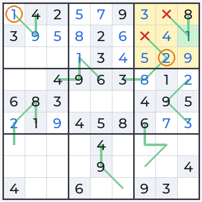

<!-- Written by tools/walkthrough.py german-whispers: edit the script, not this page. -->
# German Whispers, step 21: the 1 in box 3

**Step 21 of 51** · [← Step 20](step-20.md) · [All steps](../german-whispers.md#the-whole-puzzle-step-by-step) · [Step 22 →](step-22.md)

Box 3 needs a 1. r1c8: row 1 has one (r1c1). r2c7: it's next to the 2 in r3c8 on a green line, and 1 is less than 5 away from it. Only **r2c9** is left: **r2c9 = 1**.

**Step 21 of 51** · [← Step 20](step-20.md) · [All steps](../german-whispers.md#the-whole-puzzle-step-by-step) · [Step 22 →](step-22.md)
