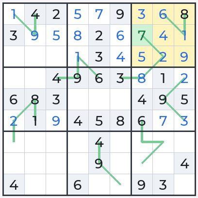

<!-- Written by tools/walkthrough.py german-whispers: edit the script, not this page. -->
# German Whispers, step 23: the 7 in box 3

**Step 23 of 51** · [← Step 22](step-22.md) · [All steps](../german-whispers.md#the-whole-puzzle-step-by-step) · [Step 24 →](step-24.md)

Box 3 needs a 7, and r2c7 is its last empty cell: **r2c7 = 7**.

**Step 23 of 51** · [← Step 22](step-22.md) · [All steps](../german-whispers.md#the-whole-puzzle-step-by-step) · [Step 24 →](step-24.md)
