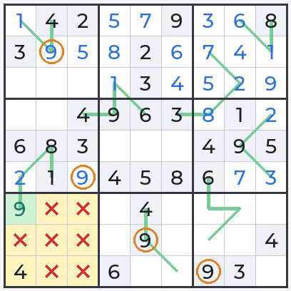

<!-- Written by tools/walkthrough.py german-whispers: edit the script, not this page. -->
# German Whispers, step 24: the 9 in box 7

**Step 24 of 51** · [← Step 23](step-23.md) · [All steps](../german-whispers.md#the-whole-puzzle-step-by-step) · [Step 25 →](step-25.md)

Box 7 needs a 9. r7c2: column 2 has one (r2c2). r7c3: column 3 has one (r6c3). r8c1, r8c2 and r8c3: row 8 has one (r8c5). r9c2 and r9c3: row 9 has one (r9c7). Only **r7c1** is left: **r7c1 = 9**.

**Step 24 of 51** · [← Step 23](step-23.md) · [All steps](../german-whispers.md#the-whole-puzzle-step-by-step) · [Step 25 →](step-25.md)
