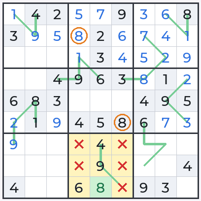

<!-- Written by tools/walkthrough.py german-whispers: edit the script, not this page. -->
# German Whispers, step 25: the 8 in box 8

**Step 25 of 51** · [← Step 24](step-24.md) · [All steps](../german-whispers.md#the-whole-puzzle-step-by-step) · [Step 26 →](step-26.md)

Box 8 needs an 8. r7c4 and r8c4: column 4 has one (r2c4). r7c6, r8c6 and r9c6: column 6 has one (r6c6). Only **r9c5** is left: **r9c5 = 8**.

**Step 25 of 51** · [← Step 24](step-24.md) · [All steps](../german-whispers.md#the-whole-puzzle-step-by-step) · [Step 26 →](step-26.md)
