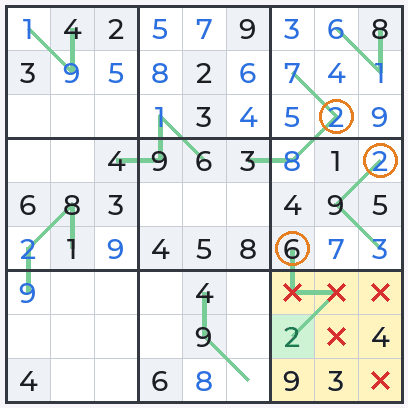

<!-- Written by tools/walkthrough.py german-whispers: edit the script, not this page. -->
# German Whispers, step 26: the 2 in box 9

**Step 26 of 51** · [← Step 25](step-25.md) · [All steps](../german-whispers.md#the-whole-puzzle-step-by-step) · [Step 27 →](step-27.md)

Box 9 needs a 2. r7c8 and r8c8: column 8 has one (r3c8). r7c9 and r9c9: column 9 has one (r4c9). r7c7: it's next to the 6 in r6c7 on a green line, and 2 is less than 5 away from it. Only **r8c7** is left: **r8c7 = 2**.

**Step 26 of 51** · [← Step 25](step-25.md) · [All steps](../german-whispers.md#the-whole-puzzle-step-by-step) · [Step 27 →](step-27.md)
