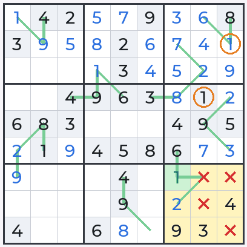

<!-- Written by tools/walkthrough.py german-whispers: edit the script, not this page. -->
# German Whispers, step 27: the 1 in box 9

**Step 27 of 51** · [← Step 26](step-26.md) · [All steps](../german-whispers.md#the-whole-puzzle-step-by-step) · [Step 28 →](step-28.md)

Box 9 needs a 1. r7c8 and r8c8: column 8 has one (r4c8). r7c9 and r9c9: column 9 has one (r2c9). Only **r7c7** is left: **r7c7 = 1**.

**Step 27 of 51** · [← Step 26](step-26.md) · [All steps](../german-whispers.md#the-whole-puzzle-step-by-step) · [Step 28 →](step-28.md)
