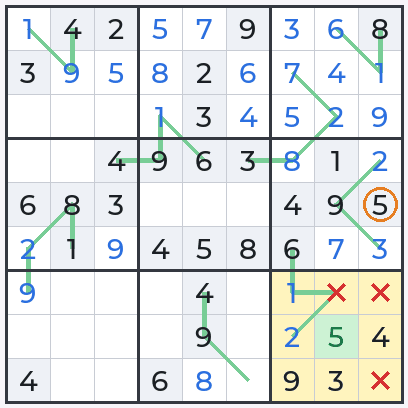

<!-- Written by tools/walkthrough.py german-whispers: edit the script, not this page. -->
# German Whispers, step 28: the 5 in box 9

**Step 28 of 51** · [← Step 27](step-27.md) · [All steps](../german-whispers.md#the-whole-puzzle-step-by-step) · [Step 29 →](step-29.md)

Box 9 needs a 5. r7c9 and r9c9: column 9 has one (r5c9). r7c8: it's on a green line, and nothing is 5 or more away from a 5. Only **r8c8** is left: **r8c8 = 5**.

**Step 28 of 51** · [← Step 27](step-27.md) · [All steps](../german-whispers.md#the-whole-puzzle-step-by-step) · [Step 29 →](step-29.md)
