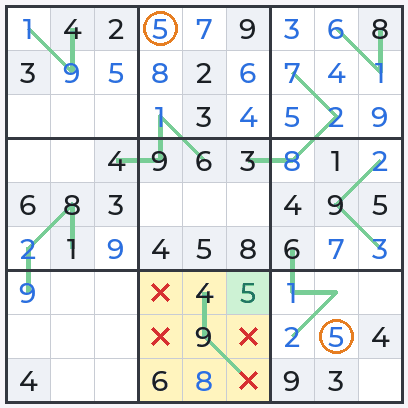

<!-- Written by tools/walkthrough.py german-whispers: edit the script, not this page. -->
# German Whispers, step 29: the 5 in box 8

**Step 29 of 51** · [← Step 28](step-28.md) · [All steps](../german-whispers.md#the-whole-puzzle-step-by-step) · [Step 30 →](step-30.md)

Box 8 needs a 5. r7c4: column 4 has one (r1c4). r8c4 and r8c6: row 8 has one (r8c8). r9c6: it's on a green line, and nothing is 5 or more away from a 5. Only **r7c6** is left: **r7c6 = 5**.

**Step 29 of 51** · [← Step 28](step-28.md) · [All steps](../german-whispers.md#the-whole-puzzle-step-by-step) · [Step 30 →](step-30.md)
