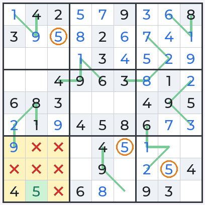

<!-- Written by tools/walkthrough.py german-whispers: edit the script, not this page. -->
# German Whispers, step 30: the 5 in box 7

**Step 30 of 51** · [← Step 29](step-29.md) · [All steps](../german-whispers.md#the-whole-puzzle-step-by-step) · [Step 31 →](step-31.md)

Box 7 needs a 5. r7c2 and r7c3: row 7 has one (r7c6). r8c1, r8c2 and r8c3: row 8 has one (r8c8). r9c3: column 3 has one (r2c3). Only **r9c2** is left: **r9c2 = 5**.

**Step 30 of 51** · [← Step 29](step-29.md) · [All steps](../german-whispers.md#the-whole-puzzle-step-by-step) · [Step 31 →](step-31.md)
