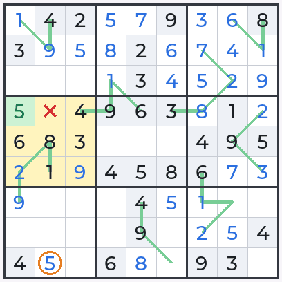

<!-- Written by tools/walkthrough.py german-whispers: edit the script, not this page. -->
# German Whispers, step 31: the 5 in box 4

**Step 31 of 51** · [← Step 30](step-30.md) · [All steps](../german-whispers.md#the-whole-puzzle-step-by-step) · [Step 32 →](step-32.md)

Box 4 needs a 5. r4c2: column 2 has one (r9c2). Only **r4c1** is left: **r4c1 = 5**.

**Step 31 of 51** · [← Step 30](step-30.md) · [All steps](../german-whispers.md#the-whole-puzzle-step-by-step) · [Step 32 →](step-32.md)
