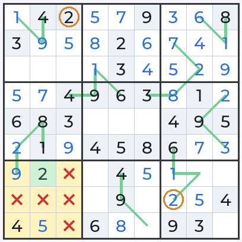

<!-- Written by tools/walkthrough.py german-whispers: edit the script, not this page. -->
# German Whispers, step 33: the 2 in box 7

**Step 33 of 51** · [← Step 32](step-32.md) · [All steps](../german-whispers.md#the-whole-puzzle-step-by-step) · [Step 34 →](step-34.md)

Box 7 needs a 2. r7c3 and r9c3: column 3 has one (r1c3). r8c1, r8c2 and r8c3: row 8 has one (r8c7). Only **r7c2** is left: **r7c2 = 2**.

**Step 33 of 51** · [← Step 32](step-32.md) · [All steps](../german-whispers.md#the-whole-puzzle-step-by-step) · [Step 34 →](step-34.md)
