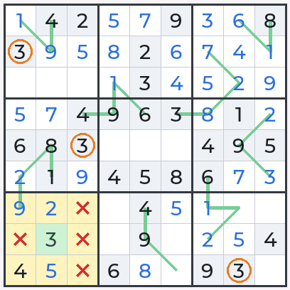

<!-- Written by tools/walkthrough.py german-whispers: edit the script, not this page. -->
# German Whispers, step 34: the 3 in box 7

**Step 34 of 51** · [← Step 33](step-33.md) · [All steps](../german-whispers.md#the-whole-puzzle-step-by-step) · [Step 35 →](step-35.md)

Box 7 needs a 3. r7c3 and r8c3: column 3 has one (r5c3). r8c1: column 1 has one (r2c1). r9c3: row 9 has one (r9c8). Only **r8c2** is left: **r8c2 = 3**.

**Step 34 of 51** · [← Step 33](step-33.md) · [All steps](../german-whispers.md#the-whole-puzzle-step-by-step) · [Step 35 →](step-35.md)
