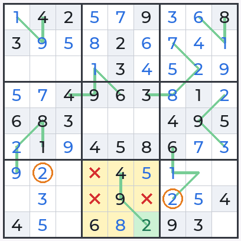

<!-- Written by tools/walkthrough.py german-whispers: edit the script, not this page. -->
# German Whispers, step 35: the 2 in box 8

**Step 35 of 51** · [← Step 34](step-34.md) · [All steps](../german-whispers.md#the-whole-puzzle-step-by-step) · [Step 36 →](step-36.md)

Box 8 needs a 2. r7c4: row 7 has one (r7c2). r8c4 and r8c6: row 8 has one (r8c7). Only **r9c6** is left: **r9c6 = 2**.

**Step 35 of 51** · [← Step 34](step-34.md) · [All steps](../german-whispers.md#the-whole-puzzle-step-by-step) · [Step 36 →](step-36.md)
