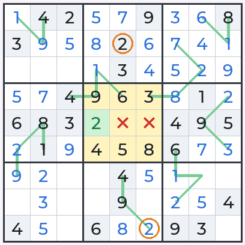

<!-- Written by tools/walkthrough.py german-whispers: edit the script, not this page. -->
# German Whispers, step 36: the 2 in box 5

**Step 36 of 51** · [← Step 35](step-35.md) · [All steps](../german-whispers.md#the-whole-puzzle-step-by-step) · [Step 37 →](step-37.md)

Box 5 needs a 2. r5c5: column 5 has one (r2c5). r5c6: column 6 has one (r9c6). Only **r5c4** is left: **r5c4 = 2**.

**Step 36 of 51** · [← Step 35](step-35.md) · [All steps](../german-whispers.md#the-whole-puzzle-step-by-step) · [Step 37 →](step-37.md)
