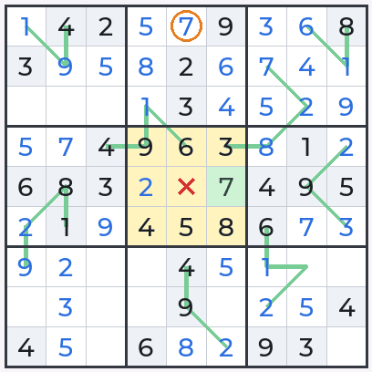

<!-- Written by tools/walkthrough.py german-whispers: edit the script, not this page. -->
# German Whispers, step 37: the 7 in box 5

**Step 37 of 51** · [← Step 36](step-36.md) · [All steps](../german-whispers.md#the-whole-puzzle-step-by-step) · [Step 38 →](step-38.md)

Box 5 needs a 7. r5c5: column 5 has one (r1c5). Only **r5c6** is left: **r5c6 = 7**.

**Step 37 of 51** · [← Step 36](step-36.md) · [All steps](../german-whispers.md#the-whole-puzzle-step-by-step) · [Step 38 →](step-38.md)
