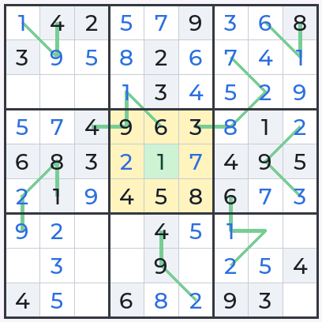

<!-- Written by tools/walkthrough.py german-whispers: edit the script, not this page. -->
# German Whispers, step 38: the 1 in box 5

**Step 38 of 51** · [← Step 37](step-37.md) · [All steps](../german-whispers.md#the-whole-puzzle-step-by-step) · [Step 39 →](step-39.md)

Box 5 needs a 1, and r5c5 is its last empty cell: **r5c5 = 1**.

**Step 38 of 51** · [← Step 37](step-37.md) · [All steps](../german-whispers.md#the-whole-puzzle-step-by-step) · [Step 39 →](step-39.md)
