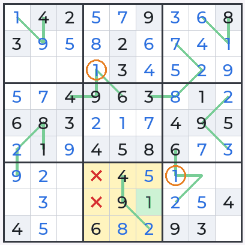

<!-- Written by tools/walkthrough.py german-whispers: edit the script, not this page. -->
# German Whispers, step 39: the 1 in box 8

**Step 39 of 51** · [← Step 38](step-38.md) · [All steps](../german-whispers.md#the-whole-puzzle-step-by-step) · [Step 40 →](step-40.md)

Box 8 needs a 1. r7c4: row 7 has one (r7c7). r8c4: column 4 has one (r3c4). Only **r8c6** is left: **r8c6 = 1**.

**Step 39 of 51** · [← Step 38](step-38.md) · [All steps](../german-whispers.md#the-whole-puzzle-step-by-step) · [Step 40 →](step-40.md)
