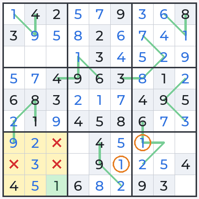

<!-- Written by tools/walkthrough.py german-whispers: edit the script, not this page. -->
# German Whispers, step 40: the 1 in box 7

**Step 40 of 51** · [← Step 39](step-39.md) · [All steps](../german-whispers.md#the-whole-puzzle-step-by-step) · [Step 41 →](step-41.md)

Box 7 needs a 1. r7c3: row 7 has one (r7c7). r8c1 and r8c3: row 8 has one (r8c6). Only **r9c3** is left: **r9c3 = 1**.

**Step 40 of 51** · [← Step 39](step-39.md) · [All steps](../german-whispers.md#the-whole-puzzle-step-by-step) · [Step 41 →](step-41.md)
