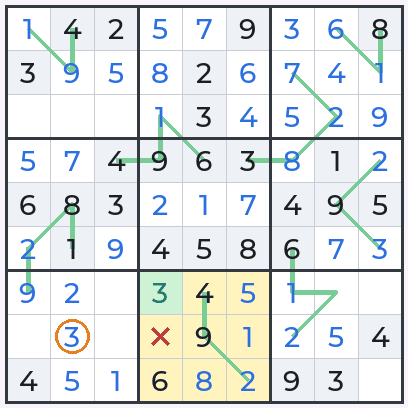

<!-- Written by tools/walkthrough.py german-whispers: edit the script, not this page. -->
# German Whispers, step 41: the 3 in box 8

**Step 41 of 51** · [← Step 40](step-40.md) · [All steps](../german-whispers.md#the-whole-puzzle-step-by-step) · [Step 42 →](step-42.md)

Box 8 needs a 3. r8c4: row 8 has one (r8c2). Only **r7c4** is left: **r7c4 = 3**.

**Step 41 of 51** · [← Step 40](step-40.md) · [All steps](../german-whispers.md#the-whole-puzzle-step-by-step) · [Step 42 →](step-42.md)
