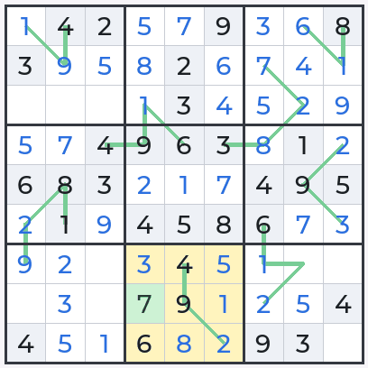

<!-- Written by tools/walkthrough.py german-whispers: edit the script, not this page. -->
# German Whispers, step 42: the 7 in box 8

**Step 42 of 51** · [← Step 41](step-41.md) · [All steps](../german-whispers.md#the-whole-puzzle-step-by-step) · [Step 43 →](step-43.md)

Box 8 needs a 7, and r8c4 is its last empty cell: **r8c4 = 7**.

**Step 42 of 51** · [← Step 41](step-41.md) · [All steps](../german-whispers.md#the-whole-puzzle-step-by-step) · [Step 43 →](step-43.md)
