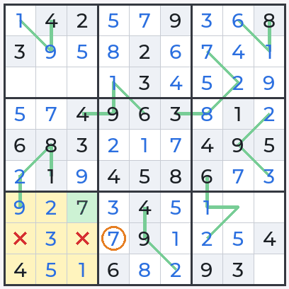

<!-- Written by tools/walkthrough.py german-whispers: edit the script, not this page. -->
# German Whispers, step 43: the 7 in box 7

**Step 43 of 51** · [← Step 42](step-42.md) · [All steps](../german-whispers.md#the-whole-puzzle-step-by-step) · [Step 44 →](step-44.md)

Box 7 needs a 7. r8c1 and r8c3: row 8 has one (r8c4). Only **r7c3** is left: **r7c3 = 7**.

**Step 43 of 51** · [← Step 42](step-42.md) · [All steps](../german-whispers.md#the-whole-puzzle-step-by-step) · [Step 44 →](step-44.md)
