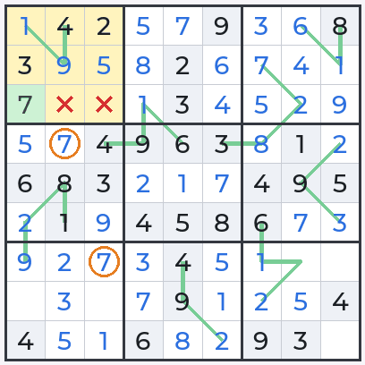

<!-- Written by tools/walkthrough.py german-whispers: edit the script, not this page. -->
# German Whispers, step 44: the 7 in box 1

**Step 44 of 51** · [← Step 43](step-43.md) · [All steps](../german-whispers.md#the-whole-puzzle-step-by-step) · [Step 45 →](step-45.md)

Box 1 needs a 7. r3c2: column 2 has one (r4c2). r3c3: column 3 has one (r7c3). Only **r3c1** is left: **r3c1 = 7**.

**Step 44 of 51** · [← Step 43](step-43.md) · [All steps](../german-whispers.md#the-whole-puzzle-step-by-step) · [Step 45 →](step-45.md)
