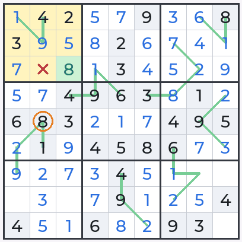

<!-- Written by tools/walkthrough.py german-whispers: edit the script, not this page. -->
# German Whispers, step 45: the 8 in box 1

**Step 45 of 51** · [← Step 44](step-44.md) · [All steps](../german-whispers.md#the-whole-puzzle-step-by-step) · [Step 46 →](step-46.md)

Box 1 needs an 8. r3c2: column 2 has one (r5c2). Only **r3c3** is left: **r3c3 = 8**.

**Step 45 of 51** · [← Step 44](step-44.md) · [All steps](../german-whispers.md#the-whole-puzzle-step-by-step) · [Step 46 →](step-46.md)
