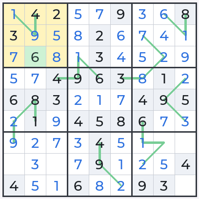

<!-- Written by tools/walkthrough.py german-whispers: edit the script, not this page. -->
# German Whispers, step 46: the 6 in box 1

**Step 46 of 51** · [← Step 45](step-45.md) · [All steps](../german-whispers.md#the-whole-puzzle-step-by-step) · [Step 47 →](step-47.md)

Box 1 needs a 6, and r3c2 is its last empty cell: **r3c2 = 6**.

**Step 46 of 51** · [← Step 45](step-45.md) · [All steps](../german-whispers.md#the-whole-puzzle-step-by-step) · [Step 47 →](step-47.md)
