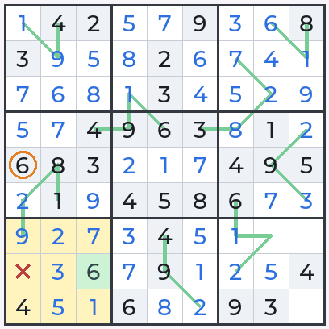

<!-- Written by tools/walkthrough.py german-whispers: edit the script, not this page. -->
# German Whispers, step 47: the 6 in box 7

**Step 47 of 51** · [← Step 46](step-46.md) · [All steps](../german-whispers.md#the-whole-puzzle-step-by-step) · [Step 48 →](step-48.md)

Box 7 needs a 6. r8c1: column 1 has one (r5c1). Only **r8c3** is left: **r8c3 = 6**.

**Step 47 of 51** · [← Step 46](step-46.md) · [All steps](../german-whispers.md#the-whole-puzzle-step-by-step) · [Step 48 →](step-48.md)
