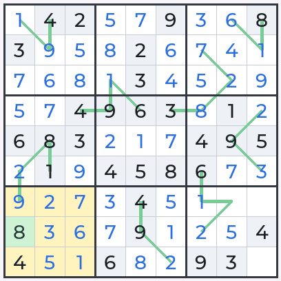

<!-- Written by tools/walkthrough.py german-whispers: edit the script, not this page. -->
# German Whispers, step 48: the 8 in box 7

**Step 48 of 51** · [← Step 47](step-47.md) · [All steps](../german-whispers.md#the-whole-puzzle-step-by-step) · [Step 49 →](step-49.md)

Box 7 needs an 8, and r8c1 is its last empty cell: **r8c1 = 8**.

**Step 48 of 51** · [← Step 47](step-47.md) · [All steps](../german-whispers.md#the-whole-puzzle-step-by-step) · [Step 49 →](step-49.md)
