# Girandola

[← All variants](README.md) · [Puzzles](../features-puzzles.md) · [How to play](../how-to-play.md)

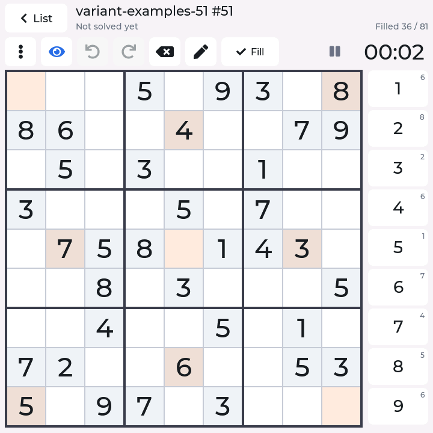

## The rules

[Classic](classic.md) rules, and **nine tinted cells in a pinwheel pattern** also hold 1 to 9, each once: r1c1, r1c9, r2c5, r5c2, r5c5, r5c8, r8c5, r9c1 and r9c9. There's one in each box.

## On the board

- The nine cells are tinted, like the Asterisk's and Center Dot's.
- Two of the same digit among them turn red, as in a row.
- The hints count the pinwheel as one more group: "the row, column, box or the pinwheel".
- **Puzzles → ⋮ → New puzzle → Grids → Girandola.**

## How to solve it

- **Scan the pinwheel like a row:** a digit placed in one of its cells is out of the other eight.
- **Hidden singles in it:** with most of its digits placed, a missing one often has one tinted cell left.
- **The corners see a lot:** r1c1 shares row 1 with r1c9 and column 1 with r9c1, so between them, the corners see five of the pinwheel's cells without it.

## Worked example

**variant-examples #51**, Girandola Easy (see [Classic](classic.md#worked-example-the-whole-puzzle) for how to import the examples; cells are written r*row*c*column*).

**Step 1: the 3 in box 1**, by the Classic rules: row 1 has a 3 (r1c7), row 3 one (r3c4). **r2c3 = 3**.

**Step 2: the 9 in box 1**: row 1 has a 9 (r1c6), column 3 one (r9c3). **r3c1 = 9**.

**Step 3: the 4 in box 1.** r1c1 is a pinwheel cell, and the pinwheel has a 4 already (r2c5); r1c3 and r3c3: column 3 has one (r7c3). Only **r1c2** is left: **r1c2 = 4**.

## The whole puzzle, step by step

<!-- walkthrough -->
<!-- Written by tools/walkthrough.py girandola: edit the script, not this part. -->

The whole puzzle, from the start to the last cell: 45 steps, each one a single (one place left for a digit, or one digit left for a cell), taken in the order a box's single comes first, so not quite the order of the worked example above. In each picture, the unit the step looks at is tinted yellow (for a cell with one digit left: its row, column and box), the new digit is on green, the digits that rule cells out have an **orange ring**, and the empty cells they rule out a **red cross**. Givens are on grey, digits from earlier steps in blue.

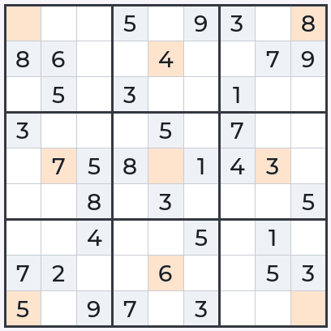

#### Step 1: the 3 in box 1

Box 1 needs a 3. r1c1, r1c2 and r1c3: row 1 has one (r1c7). r3c1 and r3c3: row 3 has one (r3c4). Only **r2c3** is left: **r2c3 = 3**.

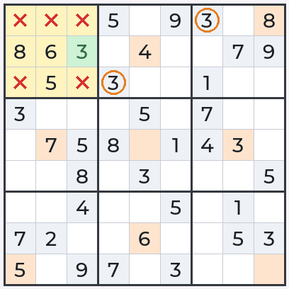

#### Step 2: the 9 in box 1

Box 1 needs a 9. r1c1, r1c2 and r1c3: row 1 has one (r1c6). r3c3: column 3 has one (r9c3). Only **r3c1** is left: **r3c1 = 9**.

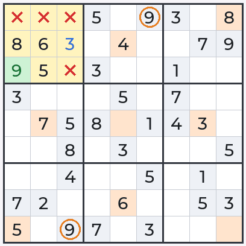

#### Step 3: the 4 in box 1

Box 1 needs a 4. r1c1: the pinwheel has one (r2c5). r1c3 and r3c3: column 3 has one (r7c3). Only **r1c2** is left: **r1c2 = 4**.

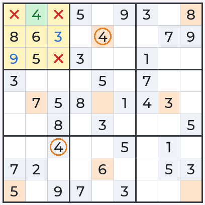

#### Step 4: the 6 in box 2

Box 2 needs a 6. r1c5 and r3c5: column 5 has one (r8c5). r2c4 and r2c6: row 2 has one (r2c2). Only **r3c6** is left: **r3c6 = 6**.

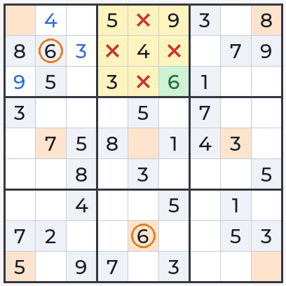

#### Step 5: the 8 in box 2

Box 2 needs an 8. r1c5: row 1 has one (r1c9). r2c4 and r2c6: row 2 has one (r2c1). Only **r3c5** is left: **r3c5 = 8**.

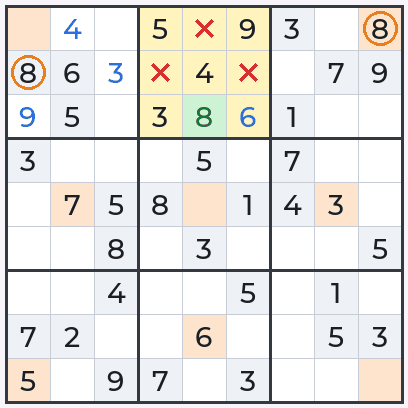

#### Step 6: the 7 in box 2

Box 2 needs a 7. r2c4 and r2c6: row 2 has one (r2c8). Only **r1c5** is left: **r1c5 = 7**.

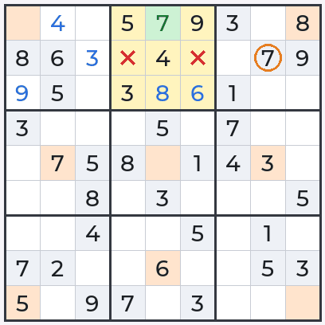

#### Step 7: the 7 in box 1

Box 1 needs a 7. r1c1 and r1c3: row 1 has one (r1c5). Only **r3c3** is left: **r3c3 = 7**.

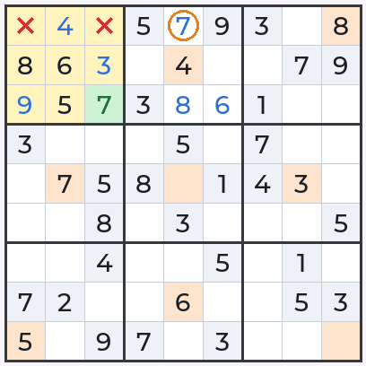

#### Step 8: the 1 in box 2

Box 2 needs a 1. r2c6: column 6 has one (r5c6). Only **r2c4** is left: **r2c4 = 1**.

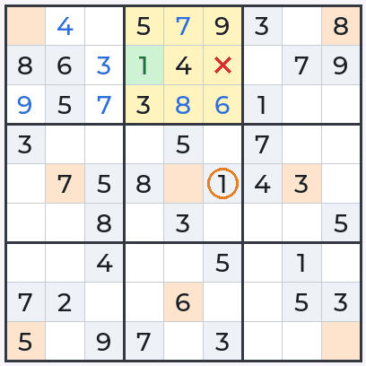

#### Step 9: the 2 in box 2

Box 2 needs a 2, and r2c6 is its last empty cell: **r2c6 = 2**.

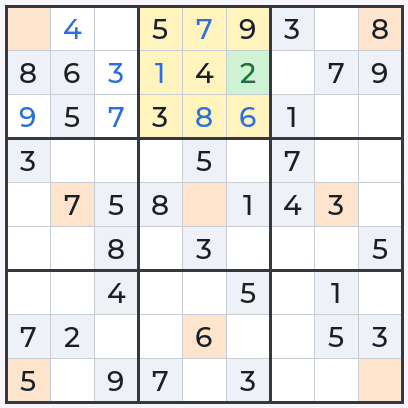

#### Step 10: the 5 in box 3

Box 3 needs a 5. r1c8: row 1 has one (r1c4). r3c8 and r3c9: row 3 has one (r3c2). Only **r2c7** is left: **r2c7 = 5**.

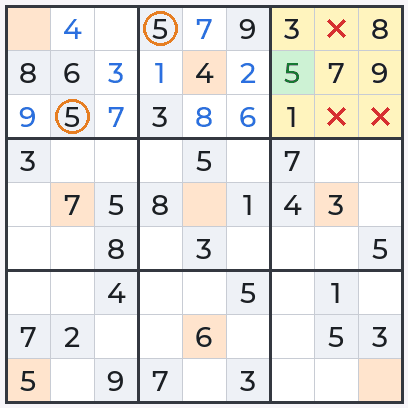

#### Step 11: the 6 in box 3

Box 3 needs a 6. r3c8 and r3c9: row 3 has one (r3c6). Only **r1c8** is left: **r1c8 = 6**.

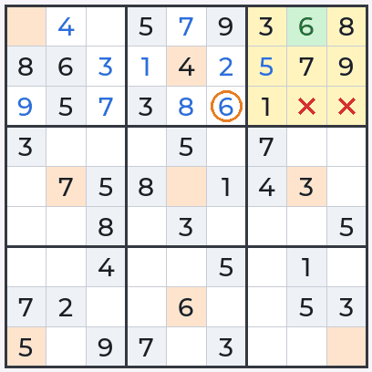

#### Step 12: the 4 in box 4

Box 4 needs a 4. r4c2 and r6c2: column 2 has one (r1c2). r4c3: column 3 has one (r7c3). r5c1: row 5 has one (r5c7). Only **r6c1** is left: **r6c1 = 4**.

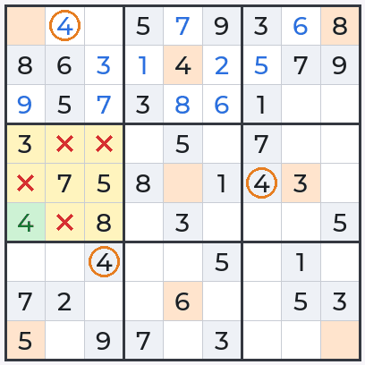

#### Step 13: the 7 in box 5

Box 5 needs a 7. r4c4 and r4c6: row 4 has one (r4c7). r5c5: row 5 has one (r5c2). r6c4: column 4 has one (r9c4). Only **r6c6** is left: **r6c6 = 7**.

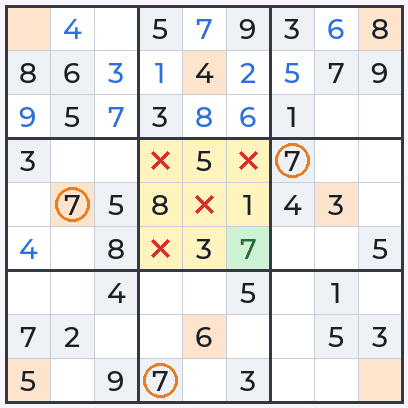

#### Step 14: the 1 in box 6

Box 6 needs a 1. r4c8 and r6c8: column 8 has one (r7c8). r5c9: row 5 has one (r5c6). r6c7: column 7 has one (r3c7). Only **r4c9** is left: **r4c9 = 1**.

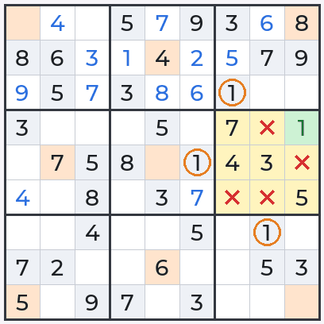

#### Step 15: the 1 in box 4

Box 4 needs a 1. r4c2 and r4c3: row 4 has one (r4c9). r5c1: row 5 has one (r5c6). Only **r6c2** is left: **r6c2 = 1**.

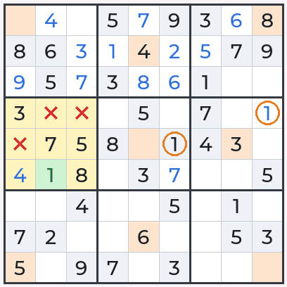

#### Step 16: the 9 in box 4

Box 4 needs a 9. r4c3: column 3 has one (r9c3). r5c1: column 1 has one (r3c1). Only **r4c2** is left: **r4c2 = 9**.

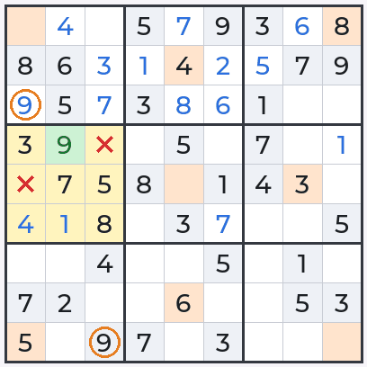

#### Step 17: the 8 in box 6

Box 6 needs an 8. r5c9: row 5 has one (r5c4). r6c7 and r6c8: row 6 has one (r6c3). Only **r4c8** is left: **r4c8 = 8**.

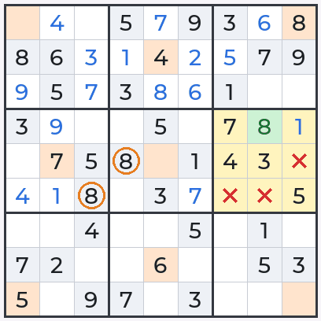

#### Step 18: the 1 in box 7

Box 7 needs a 1. r7c1 and r7c2: row 7 has one (r7c8). r9c2: column 2 has one (r6c2). Only **r8c3** is left: **r8c3 = 1**.

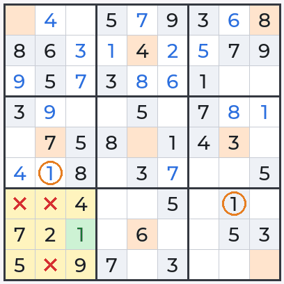

#### Step 19: the 1 in box 1

Box 1 needs a 1. r1c3: column 3 has one (r8c3). Only **r1c1** is left: **r1c1 = 1**.

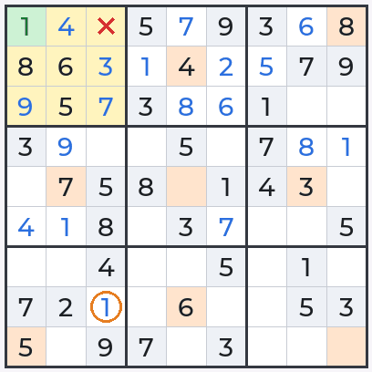

#### Step 20: the 2 in box 1

Box 1 needs a 2, and r1c3 is its last empty cell: **r1c3 = 2**.

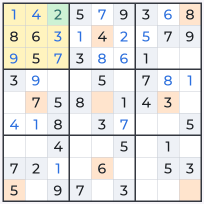

#### Step 21: the 2 in box 4

Box 4 needs a 2. r4c3: column 3 has one (r1c3). Only **r5c1** is left: **r5c1 = 2**.

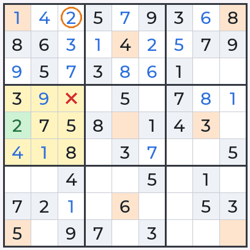

#### Step 22: the 6 in box 4

Box 4 needs a 6, and r4c3 is its last empty cell: **r4c3 = 6**.

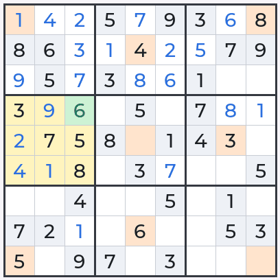

#### Step 23: the 6 in box 5

Box 5 needs a 6. r4c4 and r4c6: row 4 has one (r4c3). r5c5: column 5 has one (r8c5). Only **r6c4** is left: **r6c4 = 6**.

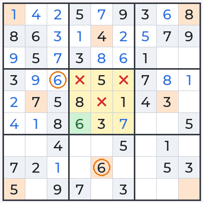

#### Step 24: the 2 in box 5

Box 5 needs a 2. r4c6: column 6 has one (r2c6). r5c5: row 5 has one (r5c1). Only **r4c4** is left: **r4c4 = 2**.

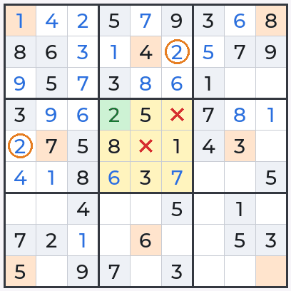

#### Step 25: the 4 in box 5

Box 5 needs a 4. r5c5: row 5 has one (r5c7). Only **r4c6** is left: **r4c6 = 4**.

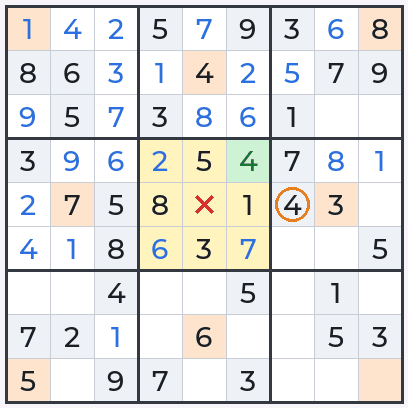

#### Step 26: the 9 in box 5

Box 5 needs a 9, and r5c5 is its last empty cell: **r5c5 = 9**.

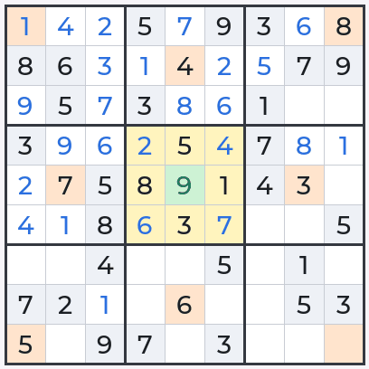

#### Step 27: the 6 in box 6

Box 6 needs a 6. r6c7 and r6c8: row 6 has one (r6c4). Only **r5c9** is left: **r5c9 = 6**.

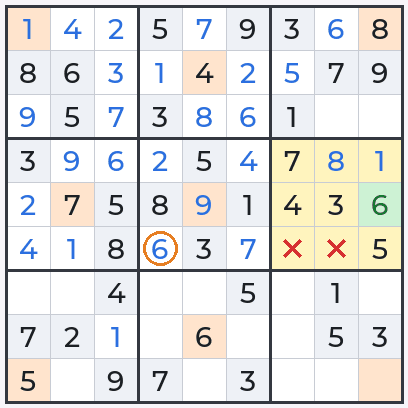

#### Step 28: the 3 in box 7

Box 7 needs a 3. r7c1: column 1 has one (r4c1). r9c2: row 9 has one (r9c6). Only **r7c2** is left: **r7c2 = 3**.

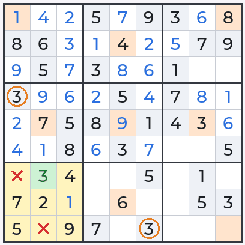

#### Step 29: the 6 in box 7

Box 7 needs a 6. r9c2: column 2 has one (r2c2). Only **r7c1** is left: **r7c1 = 6**.

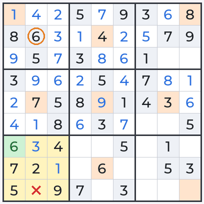

#### Step 30: the 8 in box 7

Box 7 needs an 8, and r9c2 is its last empty cell: **r9c2 = 8**.

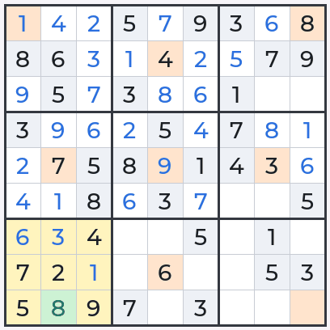

#### Step 31: the 1 in box 8

Box 8 needs a 1. r7c4 and r7c5: row 7 has one (r7c8). r8c4 and r8c6: row 8 has one (r8c3). Only **r9c5** is left: **r9c5 = 1**.

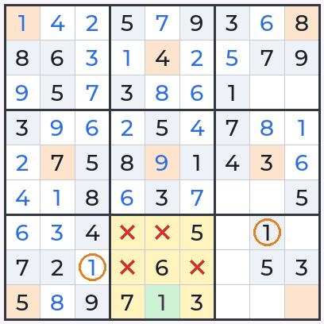

#### Step 32: the 2 in box 8

Box 8 needs a 2. r7c4: column 4 has one (r4c4). r8c4 and r8c6: row 8 has one (r8c2). Only **r7c5** is left: **r7c5 = 2**.

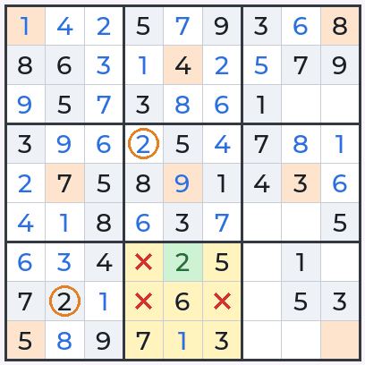

#### Step 33: the 4 in box 8

Box 8 needs a 4. r7c4: row 7 has one (r7c3). r8c6: column 6 has one (r4c6). Only **r8c4** is left: **r8c4 = 4**.

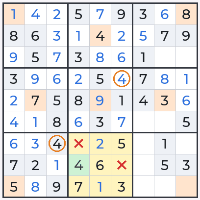

#### Step 34: the 8 in box 8

Box 8 needs an 8. r7c4: column 4 has one (r5c4). Only **r8c6** is left: **r8c6 = 8**.

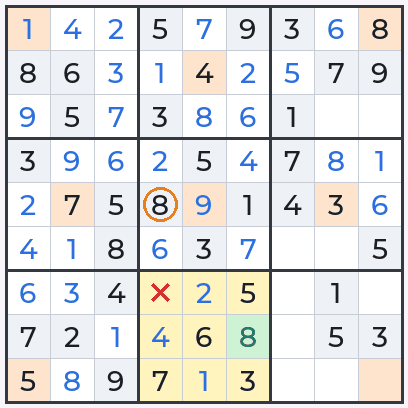

#### Step 35: the 9 in box 8

Box 8 needs a 9, and r7c4 is its last empty cell: **r7c4 = 9**.

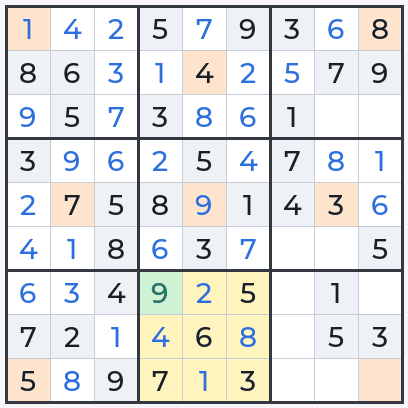

#### Step 36: the 4 in box 9

Box 9 needs a 4. r7c7 and r7c9: row 7 has one (r7c3). r8c7: row 8 has one (r8c4). r9c7: column 7 has one (r5c7). r9c9: the pinwheel has one (r2c5). Only **r9c8** is left: **r9c8 = 4**.

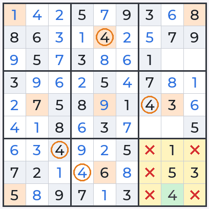

#### Step 37: the 4 in box 3

Box 3 needs a 4. r3c8: column 8 has one (r9c8). Only **r3c9** is left: **r3c9 = 4**.

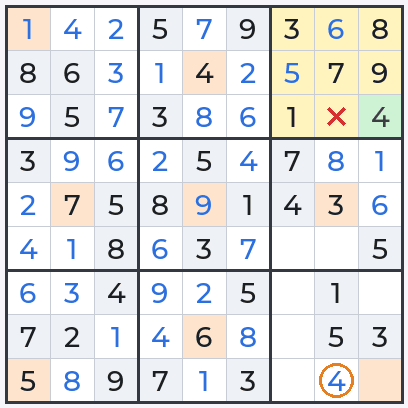

#### Step 38: the 2 in box 3

Box 3 needs a 2, and r3c8 is its last empty cell: **r3c8 = 2**.

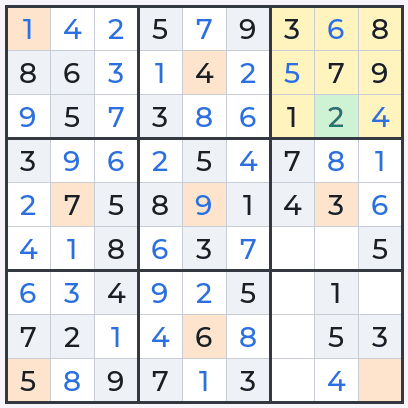

#### Step 39: the 2 in box 6

Box 6 needs a 2. r6c8: column 8 has one (r3c8). Only **r6c7** is left: **r6c7 = 2**.

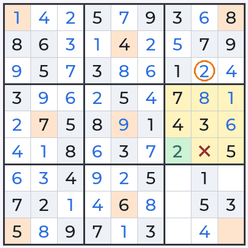

#### Step 40: the 9 in box 6

Box 6 needs a 9, and r6c8 is its last empty cell: **r6c8 = 9**.

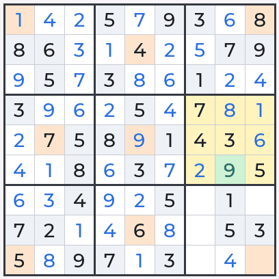

#### Step 41: the 2 in box 9

Box 9 needs a 2. r7c7 and r7c9: row 7 has one (r7c5). r8c7: row 8 has one (r8c2). r9c7: column 7 has one (r6c7). Only **r9c9** is left: **r9c9 = 2**.

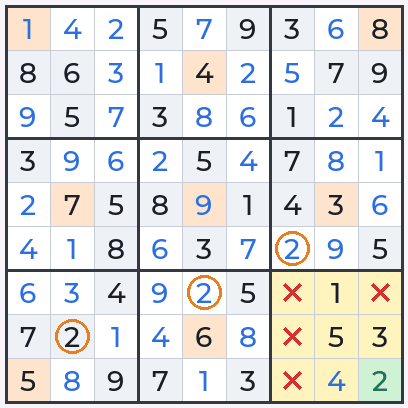

#### Step 42: the 6 in box 9

Box 9 needs a 6. r7c7 and r7c9: row 7 has one (r7c1). r8c7: row 8 has one (r8c5). Only **r9c7** is left: **r9c7 = 6**.

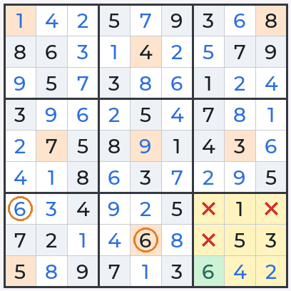

#### Step 43: the 7 in box 9

Box 9 needs a 7. r7c7: column 7 has one (r4c7). r8c7: row 8 has one (r8c1). Only **r7c9** is left: **r7c9 = 7**.

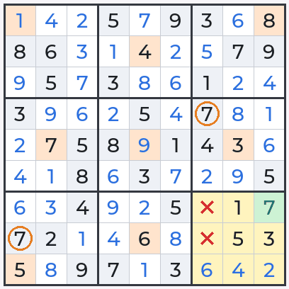

#### Step 44: the 8 in box 9

Box 9 needs an 8. r8c7: row 8 has one (r8c6). Only **r7c7** is left: **r7c7 = 8**.

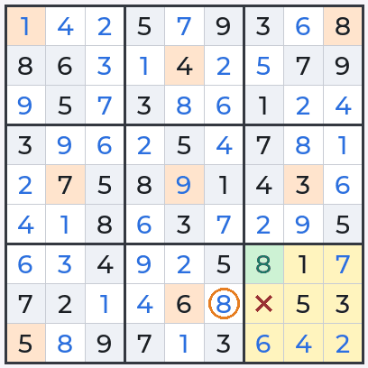

#### Step 45: the 9 in box 9

Box 9 needs a 9, and r8c7 is its last empty cell: **r8c7 = 9**.

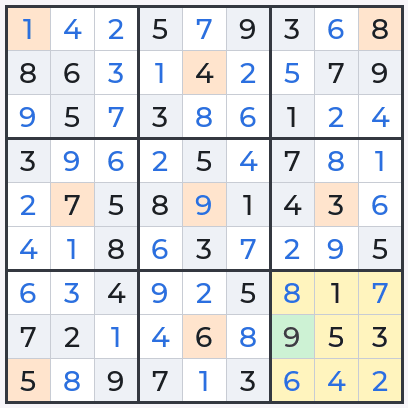

Solved.

<!-- /walkthrough -->
