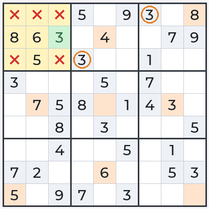

<!-- Written by tools/walkthrough.py girandola: edit the script, not this page. -->
# Girandola, step 1: the 3 in box 1

**Step 1 of 45** · [← The start](../girandola.md#the-whole-puzzle-step-by-step) · [All steps](../girandola.md#the-whole-puzzle-step-by-step) · [Step 2 →](step-02.md)

Box 1 needs a 3. r1c1, r1c2 and r1c3: row 1 has one (r1c7). r3c1 and r3c3: row 3 has one (r3c4). Only **r2c3** is left: **r2c3 = 3**.

**Step 1 of 45** · [← The start](../girandola.md#the-whole-puzzle-step-by-step) · [All steps](../girandola.md#the-whole-puzzle-step-by-step) · [Step 2 →](step-02.md)
