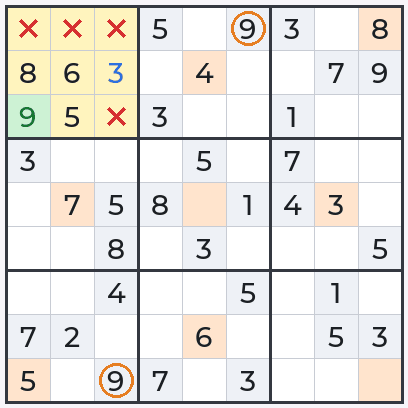

<!-- Written by tools/walkthrough.py girandola: edit the script, not this page. -->
# Girandola, step 2: the 9 in box 1

**Step 2 of 45** · [← Step 1](step-01.md) · [All steps](../girandola.md#the-whole-puzzle-step-by-step) · [Step 3 →](step-03.md)

Box 1 needs a 9. r1c1, r1c2 and r1c3: row 1 has one (r1c6). r3c3: column 3 has one (r9c3). Only **r3c1** is left: **r3c1 = 9**.

**Step 2 of 45** · [← Step 1](step-01.md) · [All steps](../girandola.md#the-whole-puzzle-step-by-step) · [Step 3 →](step-03.md)
