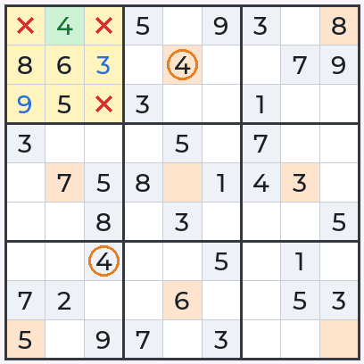

<!-- Written by tools/walkthrough.py girandola: edit the script, not this page. -->
# Girandola, step 3: the 4 in box 1

**Step 3 of 45** · [← Step 2](step-02.md) · [All steps](../girandola.md#the-whole-puzzle-step-by-step) · [Step 4 →](step-04.md)

Box 1 needs a 4. r1c1: the pinwheel has one (r2c5). r1c3 and r3c3: column 3 has one (r7c3). Only **r1c2** is left: **r1c2 = 4**.

**Step 3 of 45** · [← Step 2](step-02.md) · [All steps](../girandola.md#the-whole-puzzle-step-by-step) · [Step 4 →](step-04.md)
