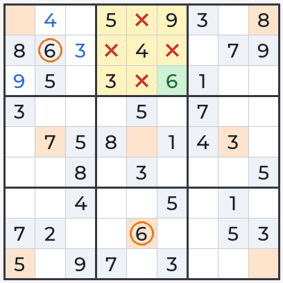

<!-- Written by tools/walkthrough.py girandola: edit the script, not this page. -->
# Girandola, step 4: the 6 in box 2

**Step 4 of 45** · [← Step 3](step-03.md) · [All steps](../girandola.md#the-whole-puzzle-step-by-step) · [Step 5 →](step-05.md)

Box 2 needs a 6. r1c5 and r3c5: column 5 has one (r8c5). r2c4 and r2c6: row 2 has one (r2c2). Only **r3c6** is left: **r3c6 = 6**.

**Step 4 of 45** · [← Step 3](step-03.md) · [All steps](../girandola.md#the-whole-puzzle-step-by-step) · [Step 5 →](step-05.md)
