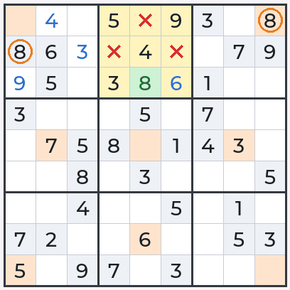

<!-- Written by tools/walkthrough.py girandola: edit the script, not this page. -->
# Girandola, step 5: the 8 in box 2

**Step 5 of 45** · [← Step 4](step-04.md) · [All steps](../girandola.md#the-whole-puzzle-step-by-step) · [Step 6 →](step-06.md)

Box 2 needs an 8. r1c5: row 1 has one (r1c9). r2c4 and r2c6: row 2 has one (r2c1). Only **r3c5** is left: **r3c5 = 8**.

**Step 5 of 45** · [← Step 4](step-04.md) · [All steps](../girandola.md#the-whole-puzzle-step-by-step) · [Step 6 →](step-06.md)
