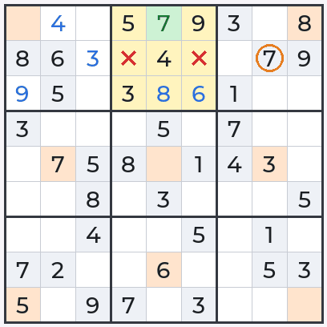

<!-- Written by tools/walkthrough.py girandola: edit the script, not this page. -->
# Girandola, step 6: the 7 in box 2

**Step 6 of 45** · [← Step 5](step-05.md) · [All steps](../girandola.md#the-whole-puzzle-step-by-step) · [Step 7 →](step-07.md)

Box 2 needs a 7. r2c4 and r2c6: row 2 has one (r2c8). Only **r1c5** is left: **r1c5 = 7**.

**Step 6 of 45** · [← Step 5](step-05.md) · [All steps](../girandola.md#the-whole-puzzle-step-by-step) · [Step 7 →](step-07.md)
