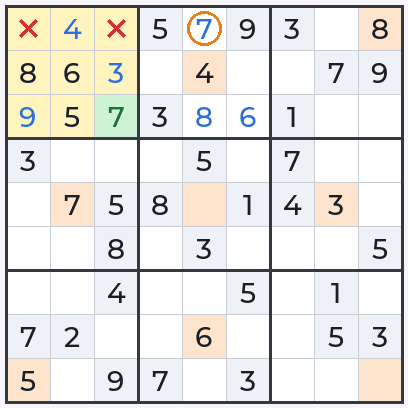

<!-- Written by tools/walkthrough.py girandola: edit the script, not this page. -->
# Girandola, step 7: the 7 in box 1

**Step 7 of 45** · [← Step 6](step-06.md) · [All steps](../girandola.md#the-whole-puzzle-step-by-step) · [Step 8 →](step-08.md)

Box 1 needs a 7. r1c1 and r1c3: row 1 has one (r1c5). Only **r3c3** is left: **r3c3 = 7**.

**Step 7 of 45** · [← Step 6](step-06.md) · [All steps](../girandola.md#the-whole-puzzle-step-by-step) · [Step 8 →](step-08.md)
