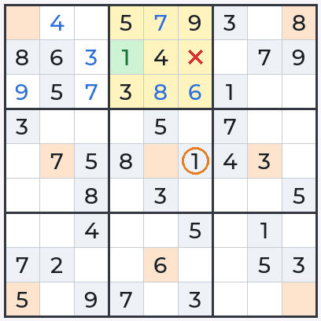

<!-- Written by tools/walkthrough.py girandola: edit the script, not this page. -->
# Girandola, step 8: the 1 in box 2

**Step 8 of 45** · [← Step 7](step-07.md) · [All steps](../girandola.md#the-whole-puzzle-step-by-step) · [Step 9 →](step-09.md)

Box 2 needs a 1. r2c6: column 6 has one (r5c6). Only **r2c4** is left: **r2c4 = 1**.

**Step 8 of 45** · [← Step 7](step-07.md) · [All steps](../girandola.md#the-whole-puzzle-step-by-step) · [Step 9 →](step-09.md)
