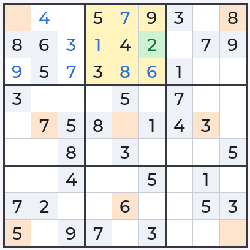

<!-- Written by tools/walkthrough.py girandola: edit the script, not this page. -->
# Girandola, step 9: the 2 in box 2

**Step 9 of 45** · [← Step 8](step-08.md) · [All steps](../girandola.md#the-whole-puzzle-step-by-step) · [Step 10 →](step-10.md)

Box 2 needs a 2, and r2c6 is its last empty cell: **r2c6 = 2**.

**Step 9 of 45** · [← Step 8](step-08.md) · [All steps](../girandola.md#the-whole-puzzle-step-by-step) · [Step 10 →](step-10.md)
