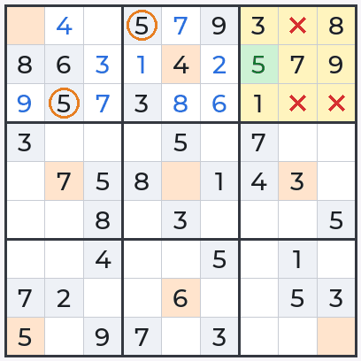

<!-- Written by tools/walkthrough.py girandola: edit the script, not this page. -->
# Girandola, step 10: the 5 in box 3

**Step 10 of 45** · [← Step 9](step-09.md) · [All steps](../girandola.md#the-whole-puzzle-step-by-step) · [Step 11 →](step-11.md)

Box 3 needs a 5. r1c8: row 1 has one (r1c4). r3c8 and r3c9: row 3 has one (r3c2). Only **r2c7** is left: **r2c7 = 5**.

**Step 10 of 45** · [← Step 9](step-09.md) · [All steps](../girandola.md#the-whole-puzzle-step-by-step) · [Step 11 →](step-11.md)
