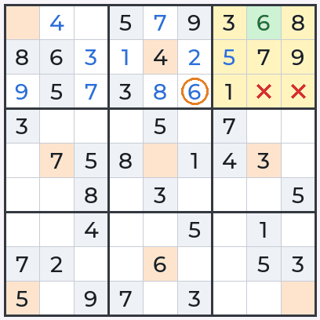

<!-- Written by tools/walkthrough.py girandola: edit the script, not this page. -->
# Girandola, step 11: the 6 in box 3

**Step 11 of 45** · [← Step 10](step-10.md) · [All steps](../girandola.md#the-whole-puzzle-step-by-step) · [Step 12 →](step-12.md)

Box 3 needs a 6. r3c8 and r3c9: row 3 has one (r3c6). Only **r1c8** is left: **r1c8 = 6**.

**Step 11 of 45** · [← Step 10](step-10.md) · [All steps](../girandola.md#the-whole-puzzle-step-by-step) · [Step 12 →](step-12.md)
